# 魚塭 RAG AI Helper

將魚池感測趨勢、養殖日誌、論文檢索和對話歷史組成回答內容的 FastAPI 服務。提供 SSE 聊天、對話保存、論文匯入與引用，並可依問題規劃時間窗，再補查指定區間的感測資料。

此服務是魚塭系統的 AI 後端，通常由 `esp32-server` 檢查使用者權限後轉接。它不是獨立的養殖診斷模型，回答的可用性取決於原始資料、檢索內容、模型能力與引用品質，不能取代現場量測和專業判斷。

## 目錄

- [功能與架構](#功能與架構)
- [環境需求](#環境需求)
- [快速開始](#快速開始)
- [模型與向量設定](#模型與向量設定)
- [論文匯入與檢索](#論文匯入與檢索)
- [對話與身分驗證](#對話與身分驗證)
- [時間窗與附件](#時間窗與附件)
- [目錄與工具](#目錄與工具)
- [測試與部署](#測試與部署)
- [常見問題與延伸文件](#常見問題與延伸文件)

## 功能與架構

| 功能 | 責任 |
|---|---|
| 魚池資訊組合 | 取得可存取的魚池、量測趨勢、日誌與選取區間 |
| 對話管理 | Session、訊息、摘要記憶與回答稽核 |
| 論文 RAG | PDF 文字、切塊、embedding、向量檢索、鄰近片段與引用 |
| 串流 | 回傳狀態、來源、token 及錯誤等 SSE 事件 |
| 模型選擇 | 依 JSON 能力設定提供模型清單、多模態與思考選項 |
| 自主補查 | 讓模型規劃受限時間窗，取得額外感測摘要後回答 |
| 維護工具 | 論文蒐集、來源清理／復原、向量重建及資料匯出 |



圖源：[architecture.mmd](docs/architecture.mmd)。主資料庫保存魚池量測，AI 資料庫保存論文、向量和對話；聊天模型與 embedding 模型分開配置。

## 環境需求

- Python，程式使用 Python 3.10+ 的型別語法；目前回歸測試環境使用 Python 3.13。其他版本仍需確認鎖定套件相容性。
- [requirements.txt](requirements.txt) 的 FastAPI、Uvicorn、asyncpg、Redis、httpx、PyJWT、pypdf 等套件。
- 可存取魚池、感測與日誌 schema 的主 PostgreSQL。
- AI PostgreSQL 與 pgvector extension。
- Redis，作為資訊與檢索快取。程式可在未設定 Redis 時啟動，但不能把這當成完整部署的快取驗收。
- 有效的模型供應商設定，或可達的本機 Ollama／相容服務。
- 使用提供的 Compose 時需要 Docker；建立資料表需 `psql`。

## 快速開始

以下從倉庫根目錄執行：

```powershell
python -m venv .venv
.venv\Scripts\python.exe -m pip install -r requirements.txt
Copy-Item example.env .env
```

編輯 `.env`，替換所有實際連線與憑證。資料庫 host、port、名稱和帳密需成組一致，不要直接沿用環境範例指向的其他系統。

| 設定 | 用途 |
|---|---|
| `MAIN_DB_DSN` 或 `DATABASE_*` | 魚塭主資料庫，唯讀查詢使用的 port 為 `DATABASE_PORT_RO` |
| `AI_DB_DSN` 或 `AI_DATABASE_*` | 論文、向量、對話和稽核資料庫 |
| `REDIS_URL` | 例如 `redis://127.0.0.1:6379/0` |
| `WEB_JWT_SECRET` | 驗證轉接端簽發的 HS256 JWT |
| `EXPECTED_JWT_ISSUER`、`EXPECTED_JWT_AUDIENCE` | 有設定時會加入驗證 |
| `LLM_DEFAULT_MODEL` | 必須對應實際模型與能力設定 |
| 各 provider key／base URL | 供應商認證和入口，詳見下一節 |
| `EMBEDDING_*` | 向量建立與查詢所用模型 |

### 啟動本機 AI 資料庫與 Redis

先在 `.env` 設定 `AI_DATABASE_NAME`、`AI_DATABASE_USER`、`AI_DATABASE_PASSWORD` 和 `AI_DATABASE_PORT`。這個 Compose 會讀取它們：

```powershell
docker compose -f docker-compose.infra.yml up -d
```

預設 AI 資料庫 host port 為 `5433`，Redis 為 `6379`。它不會建立魚塭主資料庫，也不會啟動 Python app。另一份 `docker-compose.ai-db.yml` 只有 AI DB，並有寫死的開發值，不要與 infra 配置重複啟動。

**Schema 重建會刪除 AI 資料表。** `build/buildDB.sql` 只對全新、可重建的測試 DB 執行，既有資料需先備份並規劃增量更新：

```powershell
psql -h 127.0.0.1 -p 5433 -U dev -d ai_helper_db -v ON_ERROR_STOP=1 -f build/buildDB.sql
```

這裡的 `dev`／`ai_helper_db` 對應 Compose 的開發預設；如果已修改 `.env`，命令也要一起修改。密碼由 `psql` 提示輸入，不寫在文件或 URI 中。

### 啟動 API

```powershell
.venv\Scripts\python.exe -m uvicorn main:app --host 127.0.0.1 --port 8000 --reload
```

檢查 `http://127.0.0.1:8000/docs`、`GET /`、`GET /api/system/health` 和 `GET /api/ai/models`。健康端點的 `main_db`、`ai_db`、`redis` 應分別檢查，HTTP 200 不代表三者都正常。

直接 `python main.py` 的入口固定使用 `0.0.0.0:8000`；調整部署 host／port 時請明確給 Uvicorn 參數，不要假設 `APP_HOST`／`APP_PORT` 會自動改寫這個入口。

## 模型與向量設定

[model_config.json](model_config.json) 定義模型的 provider、啟用狀態、思考類型、多模態及 temperature 限制。設定 loader 固定從專案根目錄讀取，因此不依賴呼叫端工作目錄。

| Provider | 實際使用的設定 |
|---|---|
| `openai` | `OPENAI_API_KEY`、`OPENAI_BASE_URL` |
| `gemini` | `GEMINI_API_KEY`、`GEMINI_BASE_URL` |
| `ollama`／`local-openai-compatible` | `OLLAMA_API_KEY`、`OLLAMA_BASE_URL` |
| 其他相容／舊設定 | 依程式 fallback 使用 `LLM_API_KEY`、`LLM_BASE_URL` |

對已辨識 provider 的模型，只填舊 `LLM_API_KEY` 不一定會被採用，請以 [get_provider_config](methods/ai/llm_stream.py) 的實際路徑為準。JSON 中的 `enabled=true` 只代表提供這個選項，不證明帳號已獲授權或遠端模型仍可用。

Embedding 使用獨立的 `EMBEDDING_PROVIDER`、`EMBEDDING_BASE_URL`、`EMBEDDING_API_KEY`、`EMBEDDING_MODEL` 和可選的 `EMBEDDING_DIMENSIONS`。改模型或維度時需確認現有向量與檢索的相容性，不應把不同模型的向量混成同一組搜尋結果。

需要本機 Ollama 時可參考 [docker-compose.ollama-rag.yml](docker-compose.ollama-rag.yml)，模型是否下載由配置決定，容器啟動不等於模型已存在。

## 論文匯入與檢索

1. 取得有權使用的 PDF，保留來源 URL、DOI、作者與發表資訊。
2. 依 [examplePaper](examplePaper) 的目錄與 `INDEX.md` 方式整理。空 `papers/` 不代表已有論文。
3. 透過 `/api/rag/papers` 的檔案上傳或維護腳本匯入。
4. 建立 embedding，檢查匯入工作及片段、向量數量。
5. 用有代表性的問題確認檢索與引用內容，而不是只確認模型能回字。

既有水質腳本固定讀取 `papers/water-quality/*.pdf` 與該目錄 `INDEX.md`：

```powershell
.venv\Scripts\python.exe scripts/ingest_water_quality_papers.py
.venv\Scripts\python.exe scripts/embed_paper_chunks.py
```

匯入可能替換既有論文，embedding 會連到設定的模型服務，執行前需確認資料庫、來源及額度。`rag_papers_dump.sql` 是資料快照，不代表目前都可重新取得，也不構成第三方論文的再散布授權。

## 對話與身分驗證

主要入口為 `POST /api/ai/chat/stream`；Session、模型和論文 API 請參考 [API 手冊](docs/API_MANUAL.md) 及執行中的 OpenAPI。

身分使用 Bearer JWT，payload 包含 `user_id`，並以 `WEB_JWT_SECRET` 驗證。經魚塭後端轉接時，簽發端與驗證端需相容。`ALLOW_DEV_AUTH_BYPASS` 只供受控開發環境，正式部署不要以請求中的 `user_id` 取代有效身分。

對話流程保存使用者訊息，取得魚池資訊、日誌、趨勢、檢索和摘要，必要時進行自主補查，再將模型內容與引用以 SSE 回傳並保存回答。匯入／維護 API 的驗證方式依各路由判斷，不保證每個讀取入口都具有相同限制。

## 時間窗與附件

| 選項 | 邊界 |
|---|---|
| 手動時間窗 | `time_window_from`、`time_window_to` 與 `compare_previous_window` |
| 時間窗上限 | `TIME_WINDOW_MAX_DAYS` 預設 31、`TIME_WINDOW_MAX_POINTS` 預設 500 |
| 自主補查 | `AUTONOMOUS_TIME_WINDOW_FETCH_*` 限制啟用、輪數與指標數量 |
| 論文檢索 | `RAG_*` 限制候選、擴展、鄰近片段與 context 規模 |
| 對話記憶 | `CHAT_HISTORY_*` 和 `CHAT_SESSION_SUMMARY_MAX_CHARS` |
| 附件 | 依模型能力與 provider 分流，不保證所有格式都支援 |

Chat Completions 路徑會傳送圖片、有效 file ID 和 Base64 PDF；PDF 保留檔名，其他 Base64 檔案 MIME 或缺少內容時會明確報錯。Gemini 與其他模型的附件仍需分別驗證。深度思考參數與網路搜尋也不是所有 provider 的共同能力。

時間窗裁切、比較區間與原始量測時間需一起看。缺少感測資料或論文時，不應把模型生成的合理敘述當成新增的實測證據。

## 目錄與工具

| 路徑 | 責任 |
|---|---|
| [main.py](main.py) | FastAPI app、lifespan 和服務入口 |
| [routes](routes) | AI、論文與系統 API |
| [SQL_Controller](SQL_Controller) | 主 DB 與 AI DB 的資料存取 |
| [methods/ai](methods/ai) | 驗證、對話、模型串流、記憶與時間窗 |
| [methods/rag](methods/rag) | PDF、embedding、檢索與引用 |
| [methods/infra](methods/infra) | PostgreSQL／Redis 連線與健康狀態 |
| [methods/config](methods/config) | 環境與模型能力設定 |
| [build](build) | Schema 與歷史欄位更新 |
| [scripts](scripts) | 論文蒐集、復原、向量重建、資料匯出和 CLI |
| [tests/test_readiness.py](tests/test_readiness.py) | 隔離外部依賴的 8 項回歸測試 |

CLI 使用方式可安全先看參數：

```powershell
.venv\Scripts\python.exe scripts/test_chat_cli.py --help
```

實際對話需準備魚池、有效 token 與模型，CLI 的 `--pond-id` 是必填。來源清理、替換與復原腳本有資料寫入，請先讀個別程式再使用。

## 測試與部署

不需要真實模型請求的回歸測試：

```powershell
.venv\Scripts\python.exe tests/test_readiness.py
```

這 8 項檢查涵蓋設定路徑、附件、思考參數、時間窗、啟動、模型 API 與 SSE，但資料庫和模型 HTTP 使用替身。另需實測 schema、主 DB 權限、論文匯入、embedding、檢索品質、Redis、真實 provider 與 SSE 代理。

部署時移除 `--reload`，將 API 放在受控的反向代理後方，配置 JWT、大小限制、SSE buffering／timeout 與服務程序管理。備份 AI DB、論文來源資訊和模型設定；容器 volume 不等於另一份獨立備份。

目前 SSL Context 的既有實作會在啟用 SSL 時略過主機名與憑證驗證，需另外規劃信任設定。不要因為健康檢查可回應，就宣稱連線、模型、論文內容或部署安全都已驗收。

## 常見問題與延伸文件

| 現象 | 檢查 |
|---|---|
| 模型列表空白 | JSON 是否存在、可解析且至少一個模型啟用 |
| 模型 401 | 是否填對 provider 的 API key，而非只填舊 LLM 欄位 |
| AI 401 | JWT 的 `user_id`、secret、issuer／audience 與開發 bypass 設定 |
| RAG 找不到內容 | PDF、INDEX、切塊、embedding 模型與向量資料 |
| 論文匯入找不到檔案 | 腳本的固定 `papers/water-quality` 路徑和 INDEX 對應 |
| 改模型後檢索出錯 | provider、模型名稱、向量維度與既有資料相容性 |
| 回覆不是逐字顯示 | SSE 代理、buffering、逾時與事件處理 |
| 健康 HTTP 200 但功能失敗 | 三個健康欄位是否實際為 true，以及下游模型是否可用 |

延伸閱讀：[API 手冊](docs/API_MANUAL.md)、[部署手冊](docs/DEPLOYMENT_GUIDE.md)、[論文目錄說明](examplePaper/README.md)。部署手冊中的舊 provider 範例和資料庫開發值，需以目前程式及這份文件的設定分流重新核對。

## 專案倉庫

本倉庫：[Du121793/water-quality-rag](https://github.com/Du121793/water-quality-rag)。

這個元件屬於魚塭監控與控制系統，各服務獨立部署，透過 API 或設備通訊整合。

| 元件 | 責任 |
|---|---|
| [water-quality-sensing](https://github.com/Du121793/water-quality-sensing) | ESP32 水質感測與量測上傳 |
| [remote-relay-control](https://github.com/Du121793/remote-relay-control) | STM32 遠端繼電器與設備控制 |
| [pond-monitoring-api](https://github.com/Du121793/pond-monitoring-api) | 魚池資料、權限與告警 API |
| [water-quality-rag](https://github.com/Du121793/water-quality-rag) | 水質論文 RAG 與魚池資料問答 |
| 魚塭前端 | 監控介面與管理操作，發布網址待確認 |

## 本機私有設定

公開倉庫只提供範例設定。實際 `.env`、API token、Wi-Fi 密碼、裝置金鑰和私有設定檔保留在本機，範例占位值必須換成自己的設定才能使用相應服務。
